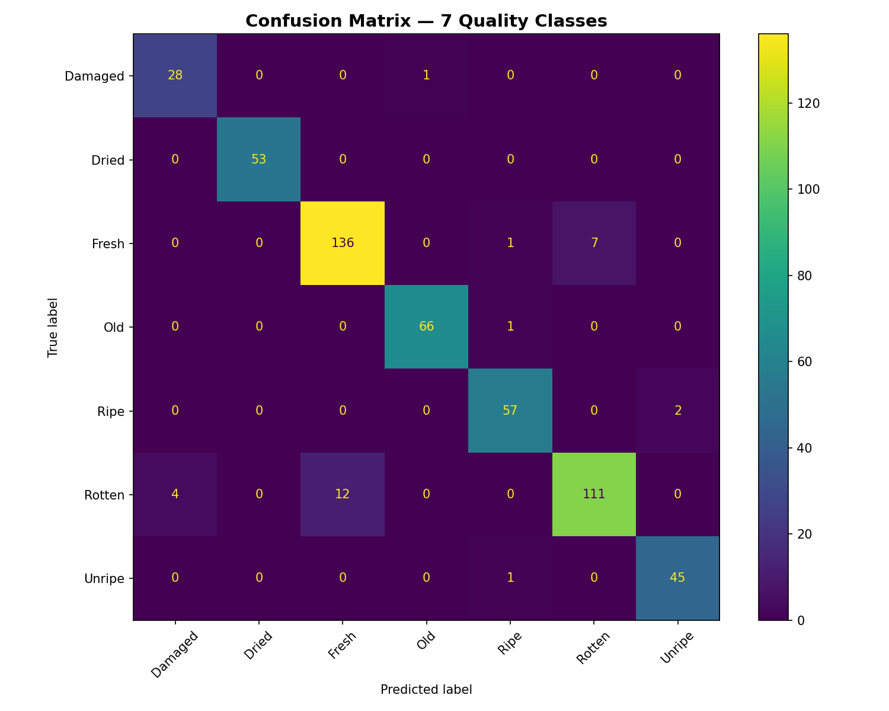
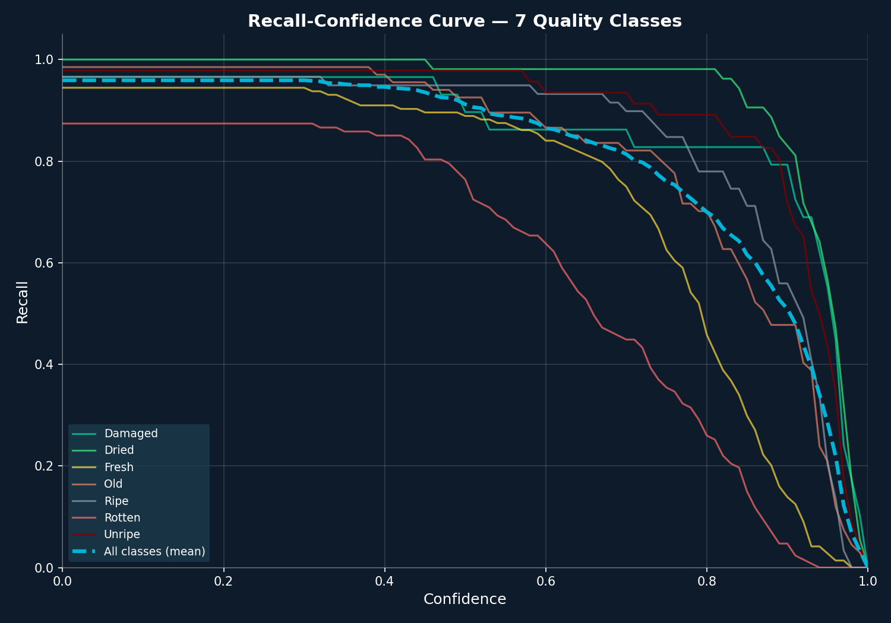

# AI-Powered Food Quality Inspection & Freshness Assessment System

[](https://www.python.org/)
[](https://pytorch.org/)
[](https://github.com/ultralytics/ultralytics)
[](https://streamlit.io/)
[](https://opencv.org/)
[](#evaluation--benchmarks)

An end-to-end computer vision and deep learning system that automates agricultural produce grading, defect detection, species identification, and degradation forecasting across images and video streams.

---

## Executive Summary

- **Multi-Stage AI Architecture**: Combines **YOLO** (object localization), **ResNet-50** (7-tier quality classification), **MobileNetV2** (36-species recognition), **OpenCV** (pixel-level defect segmentation), and a **Bi-LSTM** (temporal shelf-life trend forecasting).
- **High-Accuracy Benchmarks**: Achieved **94.48% test accuracy** and a **95.24% macro F1-score** across 3,500 standardized produce images, with a peak validation accuracy of **96.19%**.
- **Automated Defect Quantification**: Isolates surface bruises, rot, dehydration, and discoloration, computing exact surface defect area percentages and severity tiers (Low, Medium, High).
- **Interactive Decision Dashboard**: Deploys an intuitive Streamlit interface featuring live inspection telemetry, 0–6 quality scoring, temporal degradation graphs, and instant reporting.

---

## Problem & Business Impact

Manual agricultural quality inspection is labor-intensive, subjective, and prone to human inconsistency, causing substantial commercial losses across cold chains, grocery retail, and food processing facilities. 

This system automates food quality triage by standardizing inspection into objective, auditable metrics. By combining spatial defect detection with temporal deterioration forecasting, supply chain operators can identify spoiled batches earlier, reduce food waste, and automate sorting at scale.

---

## Core Architecture & Pipeline


1. **Produce Localization (YOLO)**: Detects and isolates agricultural produce targets from cluttered visual backgrounds.
2. **Species Identification (MobileNetV2)**: Classifies the specific fruit or vegetable across 36 fine-grained categories with **91.36% test accuracy**.
3. **Quality Grading (ResNet-50)**: Extracts deep visual representations to categorize freshness into seven distinct quality tiers.
4. **Defect Segmentation (OpenCV)**: Analyzes HSV and LAB color channels and edge contours to segment damaged tissue, quantify defect area percentage, and assign severity.
5. **Deterioration Forecasting (Bi-LSTM)**: Analyzes sequential quality ratings over a 10-frame sliding window to predict whether produce is *Improving*, *Stable*, or *Degrading*.
6. **Unified Decision UI (Streamlit)**: Translates multi-model outputs into a standardized 0–6 quality score, interactive trend visualizations, and downloadable audit logs.

---

## Evaluation & Benchmarks

The quality classification model was evaluated on a verified test set of 525 images (from a 3,500-image dataset) across seven operational condition classes:

### Overall Performance

| Metric | Score | Key Takeaway |
|---|---|---|
| **Test Accuracy** | **94.48%** | Robust generalization on unseen visual samples |
| **Best Validation Accuracy** | **96.19%** | High convergence during training |
| **Macro Precision** | **94.67%** | Minimal false positive classification across classes |
| **Macro Recall** | **95.91%** | Strong sensitivity in detecting damaged and deteriorating items |
| **Macro F1-Score** | **95.24%** | Balanced harmonic precision-recall performance |

### Per-Class Quality Grading Breakdown

| Quality Class | Precision | Recall | F1-Score | Operational Severity / Action |
|---|---|---|---|---|
| **Dried** | 100.00% | 100.00% | **100.00%** | Dehydrated stock; discount or repurpose |
| **Old** | 98.51% | 98.51% | **98.51%** | Past prime shelf-life; expedite distribution |
| **Unripe** | 95.74% | 97.83% | **96.77%** | Pre-retail storage; route to ripening chambers |
| **Ripe** | 95.00% | 96.61% | **95.80%** | Prime retail quality; ready for immediate sale |
| **Fresh** | 91.89% | 94.44% | **93.15%** | Highest commercial grade (Score 6/6) |
| **Damaged** | 87.50% | 96.55% | **91.80%** | Physical surface bruise/puncture; reject from premium |
| **Rotten** | 94.07% | 87.40% | **90.61%** | Microbial rot/decay; immediate culling (Score 0/6) |

---

## Technology Stack

| Layer | Technologies | Functional Responsibility |
|---|---|---|
| **Deep Learning Framework** | PyTorch, TorchVision | Model training, transfer learning, and GPU/CPU tensor execution |
| **Produce Localization** | Ultralytics YOLOv8 / YOLOv9 | Zero-shot open-vocabulary and pre-trained object localization |
| **Feature Extraction & Quality** | ResNet-50 | Deep convolutional backbone fine-tuned for 7-class freshness grading |
| **Species Classifier** | MobileNetV2 | Lightweight, low-latency 36-class produce taxonomy classifier |
| **Temporal Forecasting** | Bi-LSTM (`TrendLSTM`) | Recurrent network modeling deterioration trends over sequential frames |
| **Computer Vision** | OpenCV (cv2), NumPy | LAB/HSV color segmentation, morphological filtering, and contour mapping |
| **Interactive Dashboard** | Streamlit, Plotly, Custom CSS | Production web UI, interactive Plotly charts, and telemetry cards |

---

## Visual Evaluation

| Confusion Matrix | F1 vs. Confidence Curve |
|---|---|
| <br/>*Confusion matrix illustrating strong diagonal class separation across all 7 grades.* | <br/>*Macro F1-score optimization across decision confidence thresholds.* |

| Precision vs. Confidence | Recall vs. Confidence |
|---|---|
| <br/>*Precision stability under operational detection thresholds.* | <br/>*Recall retention demonstrating high capture rates for defective produce.* |

---

## Technical Highlights & Engineering Decisions

1. **Composite Color-Space Defect Segmentation**: Traditional RGB thresholding fails under natural lighting. The system utilizes combined **LAB** (luminance anomaly detection) and **HSV** (saturation/hue shifts) color models with morphological closing to reliably isolate bruising and fungal rot.
2. **Hierarchical Two-Step Classification**: Separating produce identification (MobileNetV2) from quality condition grading (ResNet-50) allows the quality model to remain domain-agnostic and scalable across fruits and vegetables without retraining for every species.
3. **Temporal Trend Modeling**: A single snapshot cannot capture deterioration dynamics. The integrated Bi-LSTM processes chronological quality state vectors, generating predictive warnings before visible decay spoils entire storage crates.
4. **Optimized Inference Workflow**: Neural models are cached using Streamlit's `@st.cache_resource`, while forward passes run under `torch.no_grad()` to maintain low-latency inference on desktop and edge devices.

---

## Quickstart

### 1. Environment Setup
```bash
git clone https://github.com/Janardhan-Jillela/AI-Food-Quality-Inspection.git
cd AI-Food-Quality-Inspection

python -m venv venv
# Windows:
.\venv\Scripts\Activate.ps1
# Linux / macOS:
source venv/bin/activate
```

### 2. Install Dependencies
```bash
pip install torch torchvision opencv-python ultralytics streamlit numpy pillow plotly scikit-learn
```

### 3. Run the Dashboard
```bash
streamlit run app.py
```
*Open your browser at `http://localhost:8501` to access the inspection system.*

---

## Author & Project Information

**Janardhan Jillela**  
Lead Developer & Author  
- **GitHub**: [@Janardhan-Jillela](https://github.com/Janardhan-Jillela)  
- **Email**: `22091A3248@rgmcet.edu.in`  
- **Institution**: Department of Computer Science and Engineering (Data Science), Rajeev Gandhi Memorial College of Engineering & Technology (Autonomous), Nandyal, Andhra Pradesh, India  

*License*: Academic & Research Use.
