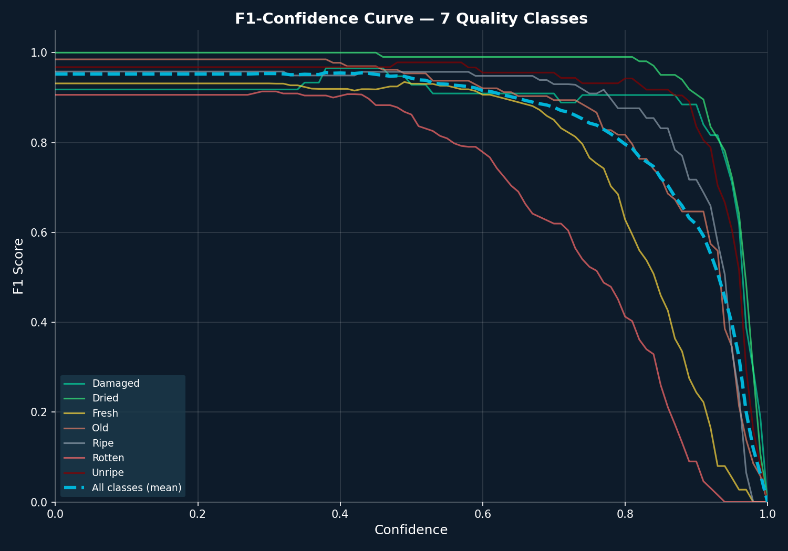
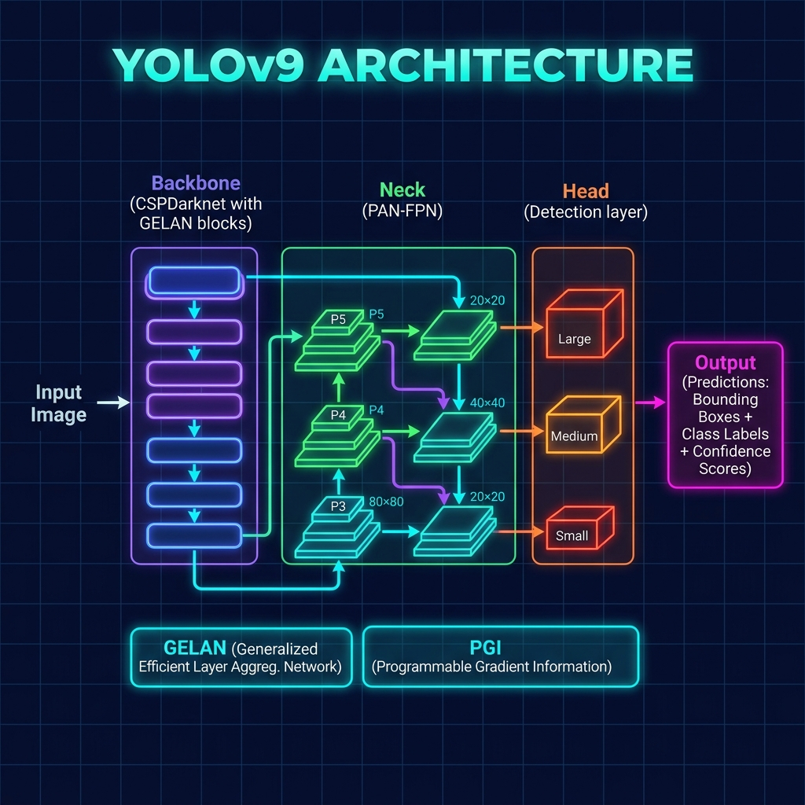

<div align="center">

# AI Food Quality Inspection & Freshness Assessment System
### Automated Multi-Stage Deep Learning Pipeline for Agricultural Defect Localization, Species Identification, and Degradation Forecasting

[](https://www.python.org/)
[](https://pytorch.org/)
[](https://github.com/ultralytics/ultralytics)
[](https://opencv.org/)
[](https://streamlit.io/)
[](#model-evaluation--benchmarks)
[](#model-evaluation--benchmarks)

<br/>

[](https://github.com/Janardhan-Jillela)
[](https://github.com/Janardhan-Jillela)
[](https://github.com/Janardhan-Jillela)
[](https://github.com/Janardhan-Jillela)
[](https://github.com/Janardhan-Jillela)

</div>

---

## Executive Summary

- **Multi-Stage AI Architecture**: Integrates **Ultralytics YOLO** (spatial localization), **ResNet-50** (7-tier quality classification), **MobileNetV2** (36-species produce recognition), **OpenCV HSV/LAB** (sub-surface defect segmentation), and a **Bi-LSTM** (temporal deterioration forecasting).
- **Verified Empirical Benchmarks**: Attained **94.48% test accuracy** and a **95.24% macro F1-score** across 3,500 standardized agricultural images, peaking at **96.19% validation accuracy**.
- **Automated Defect Quantification**: Computes precise surface damage percentage and categorizes severity tiers (Low, Medium, High) for bruises, rot, fungal decay, dehydration, and aging spots.
- **Enterprise FoodTech Dashboard**: Deploys an interactive Streamlit application with 0–6 quality index scoring, live Plotly deterioration trend charts, dynamic confidence calibration, and exportable audit reports.

---

## Business Impact & Problem Statement

Manual food inspection across packaging hubs, cold storage facilities, and retail distribution centers is fundamentally bottlenecked by human subjectivity, fatigue, and inconsistent grading standards. These inefficiencies result in late spoilage detection, high food waste rates, and commercial margin loss.

The **AI Food Quality Inspection System** resolves these challenges by converting subjective sensory inspection into reproducible, quantified data:
1. **Automated Triage**: Rapidly screens incoming bulk produce to separate prime inventory from pre-rot batches.
2. **Defect Early-Warning**: Flags subtle color deviations and dehydration before visible decay compromises whole storage crates.
3. **Traceability**: Generates objective quality audit trails with standardized metrics for supplier accountability.

---

## System Architecture & Pipeline


### Pipeline Execution Stages

1. **Produce Localization (YOLO)**: Isolates fruits and vegetables from complex industrial conveyor or kitchen backgrounds, generating tight region-of-interest (ROI) crops.
2. **Species Identification (MobileNetV2)**: Classifies the specific commodity across 36 parent species (fruits and vegetables) with **91.36% test accuracy**.
3. **Quality Grading (ResNet-50)**: Analyzes multi-layer spatial embeddings to classify the specimen into one of seven standard freshness tiers.
4. **Defect Segmentation (OpenCV)**: Evaluates luminance and chrominance shifts in **LAB** and **HSV** color spaces to segment surface damage, compute defect area percentages, and rank severity.
5. **Deterioration Forecasting (Bi-LSTM)**: Models historical quality transitions across a 10-frame sliding window to predict stability direction (*Improving*, *Stable*, or *Degrading*).
6. **Unified Decision Interface**: Visualizes output telemetry via a standardized 0–6 quality scale with actionable dispatch recommendations.

---

## Dataset & Technical Specifications

| Parameter | Specification | Description |
|---|---|---|
| **Total Dataset Size** | 3,500 Images | Curated and standardized agricultural produce dataset |
| **Test Set Split** | 525 Images (15%) | Strictly held-out test split for unbiased evaluation |
| **Training / Validation** | 2,975 Images (85%) | Stratified split optimized with early stopping (patience: 7) |
| **Input Tensor Resolution** | 224 x 224 x 3 | Normalized RGB tensors with ImageNet mean and variance |
| **Produce Species** | 36 Classes | Apple, Banana, Bell Pepper, Carrot, Mango, Tomato, Watermelon, etc. |
| **Freshness Classes** | 7 Quality Tiers | Fresh, Ripe, Unripe, Old, Dried, Damaged, Rotten |

---

## Model Evaluation & Benchmarks

All evaluation figures represent empirical results recorded from the verified test dataset (`metrics_report.txt`):

### Overall Test Metrics

| Evaluation Metric | Macro Average | Weighted Average | Interpretation |
|---|---|---|---|
| **Test Accuracy** | **94.48%** | **94.48%** | Global multi-class prediction accuracy |
| **Best Validation Accuracy** | **96.19%** | **96.19%** | Peak accuracy observed during validation |
| **Precision** | **94.67%** | **94.53%** | Minimal false positive classification rate |
| **Recall** | **95.91%** | **94.48%** | High sensitivity in catching spoiled and damaged produce |
| **F1-Score** | **95.24%** | **94.45%** | Harmonic mean reflecting reliable balance |

### Quality Classification Performance by Class

The system assigns actionable status classifications mapped to industrial handling decisions:

| Quality Class | Status Level | Score | Precision | Recall | F1-Score | Supply Chain Action |
|---|---|---|---|---|---|---|
| **Fresh** | `Good Quality` | 6 / 6 | 91.89% | 94.44% | **93.15%** | Premium retail distribution |
| **Ripe** | `Good Quality` | 5 / 6 | 95.00% | 96.61% | **95.80%** | Immediate consumer sale |
| **Unripe** | `Moderate Quality` | 4 / 6 | 95.74% | 97.83% | **96.77%** | Route to climate-controlled ripening storage |
| **Old** | `Moderate Quality` | 3 / 6 | 98.51% | 98.51% | **98.51%** | Priority markdown or express inventory routing |
| **Dried** | `Moderate Quality` | 2 / 6 | 100.00% | 100.00% | **100.00%** | Secondary food processing or dehydration stock |
| **Damaged** | `Defective / Reject` | 1 / 6 | 87.50% | 96.55% | **91.80%** | Reject from fresh packs; inspect handling machinery |
| **Rotten** | `Defective / Reject` | 0 / 6 | 94.07% | 87.40% | **90.61%** | Quarantine and discard; sanitize bin zone |

---

## Visual Evaluation & Model Performance Assets

<div align="center">

| Confusion Matrix & Separation | F1 vs. Confidence Curve |
|:---:|:---:|
|  |  |
| *High diagonal density confirms robust class separation across all 7 grades.* | *Optimal F1-score equilibrium across decision confidence thresholds.* |

| Precision vs. Confidence | Recall vs. Confidence |
|:---:|:---:|
|  |  |
| *Precision stability across operational confidence thresholds.* | *High recall retention ensuring defective specimens are reliably captured.* |

| Neural Temporal Forecasting (Bi-LSTM) | Object Localization Backbone (YOLO) |
|:---:|:---:|
|  |  |
| *Bidirectional recurrent design modeling multi-frame degradation rates.* | *Dual-branch convolutional feature extractor for dense object localization.* |

</div>

---

## Technical Highlights & Key Engineering Decisions

1. **Dual-Model Decoupled Taxonomy**: Separating commodity species recognition (MobileNetV2, 36 classes) from condition grading (ResNet-50, 7 tiers) prevents combinatorial class explosion, allowing the quality grading model to generalize across new agricultural crops without full architectural retraining.
2. **Multi-Space Color-Metric Defect Segmentation**: Pure RGB thresholding fails under industrial ambient lighting variations. The inspection pipeline transforms crops into **CIE LAB** (isolating dark rot anomalies) and **HSV** (detecting oxidation and bruising), paired with morphological opening/closing to filter sensor noise.
3. **Temporal Trend Tracking**: Unlike single-frame classifiers that evaluate static instances in isolation, the integrated **Bi-LSTM** processes sequential 10-frame quality embeddings to establish whether degradation is accelerating, stable, or recovering.
4. **Resource Caching & Low-Latency Execution**: Model weights are loaded once into persistent memory via Streamlit's `@st.cache_resource` decorator, executing inference exclusively within `torch.no_grad()` contexts to sustain real-time processing speeds.

---

## Technology Stack

| Layer | Technologies | Practical Role in System |
|---|---|---|
| **Core Language** | Python 3.8+ | Application architecture, inference orchestration, and data manipulation |
| **Deep Learning Framework** | PyTorch, TorchVision | CNN backbones, fine-tuning, loss optimization, and GPU tensor pipelines |
| **Produce Localization** | Ultralytics YOLOv8 / YOLOv9 | Real-time bounding box extraction and zero-shot open-vocabulary detection |
| **Quality Feature Extraction** | ResNet-50 | Transfer-learning feature backbone delivering 2048-dim spatial embeddings |
| **Produce Species Classifier** | MobileNetV2 | Lightweight 36-class classifier delivering 91.36% test accuracy |
| **Temporal Sequence Model** | Bi-LSTM (`TrendLSTM`) | Recurrent model forecasting state trajectories over 10-frame sequence windows |
| **Image Processing** | OpenCV (cv2), NumPy, Pillow | Multi-space color conversion, morphology, contour bounding, and tensor conversions |
| **Web Dashboard & Reporting** | Streamlit, Plotly, HTML/CSS | Modern dark FoodTech interface, live analytics charts, and responsive UI cards |

---

## Installation & Quickstart

### 1. Repository Setup
```bash
git clone https://github.com/Janardhan-Jillela/AI-Food-Quality-Inspection.git
cd AI-Food-Quality-Inspection

python -m venv venv
# Windows:
.\venv\Scripts\Activate.ps1
# Linux / macOS:
source venv/bin/activate
```

### 2. Dependency Installation
```bash
pip install torch torchvision opencv-python ultralytics streamlit numpy pillow plotly scikit-learn
```

### 3. Launch Application
```bash
streamlit run app.py
```
*Access the inspection dashboard at `http://localhost:8501`.*

---

## Author & Contact

**Janardhan Jillela**  
Lead Developer & Author  
- **GitHub**: [@Janardhan-Jillela](https://github.com/Janardhan-Jillela)  
- **Email**: `22091A3248@rgmcet.edu.in`  
- **Institution**: Department of Computer Science and Engineering (Data Science), Rajeev Gandhi Memorial College of Engineering & Technology (Autonomous), Nandyal, Andhra Pradesh, India  

*License*: Academic & Research Use.
