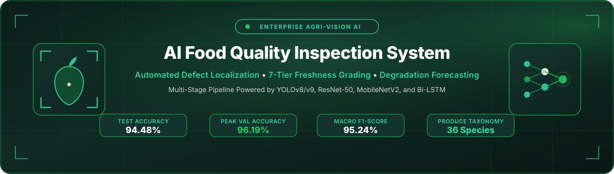
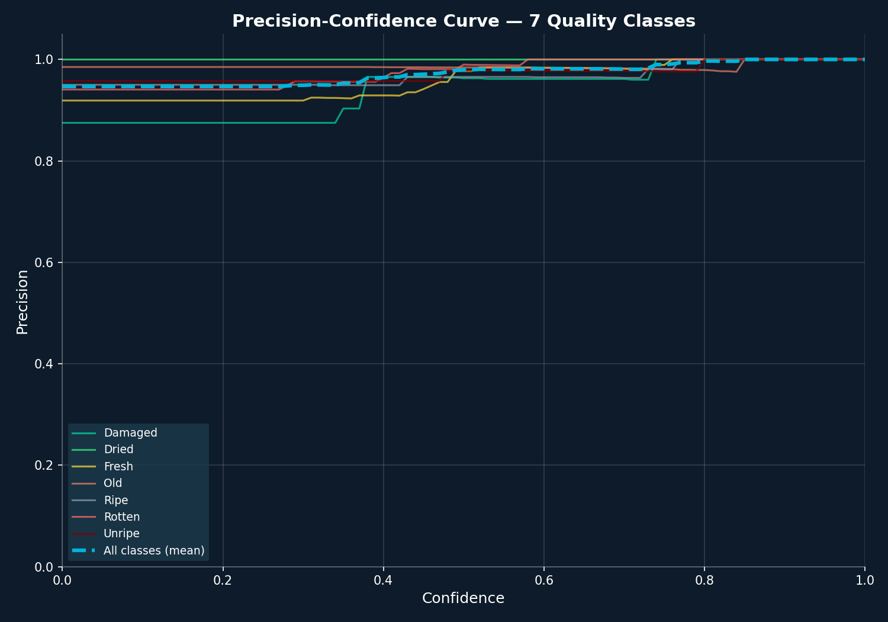
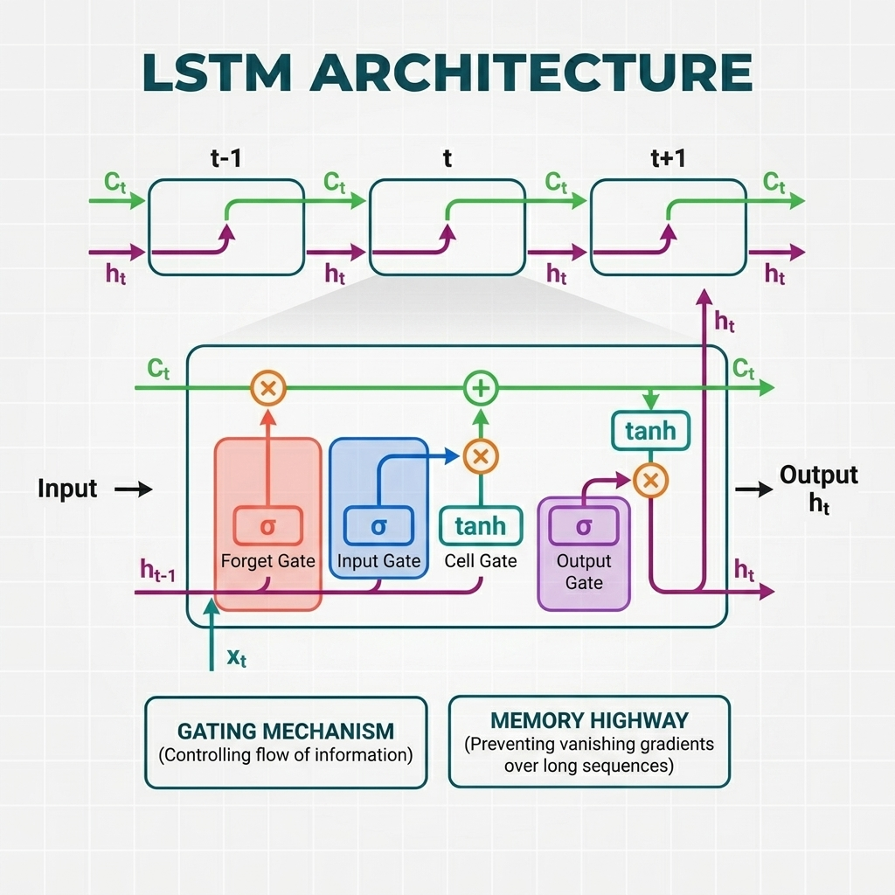

<div align="center">



<br/>

[](https://www.python.org/)
[](https://pytorch.org/)
[](https://github.com/ultralytics/ultralytics)
[](https://opencv.org/)
[](https://streamlit.io/)
[](#model-performance--benchmarks)
[](#model-performance--benchmarks)

<br/>

[](https://github.com/Janardhan-Jillela)
[](https://github.com/Janardhan-Jillela)
[](https://github.com/Janardhan-Jillela)
[](https://github.com/Janardhan-Jillela)
[](https://github.com/Janardhan-Jillela)

</div>

---

## Executive Overview

The **AI Food Quality Inspection System** is an enterprise-grade computer vision and deep learning platform engineered to automate agricultural produce grading, defect localization, species taxonomy classification, and shelf-life degradation forecasting.

By combining spatial deep learning architectures (**YOLO**, **ResNet-50**, **MobileNetV2**) with pixel-level color segmentation (**OpenCV HSV/LAB**) and temporal sequence modeling (**Bi-LSTM**), the system standardizes sensory food grading into auditable, high-throughput quantitative metrics.

- **Automated Defect Triage**: Quantifies surface bruise, rot, and dehydration area percentages, classifying severity into Low, Medium, and High tiers.
- **Robust Empirical Accuracy**: Attained **94.48% test accuracy** and a **95.24% macro F1-score** across 3,500 standardized produce samples, reaching a peak validation accuracy of **96.19%**.
- **Temporal Deterioration Forecasting**: Uses recurrent sequence modeling across a 10-frame sliding window to predict whether produce quality is *Improving*, *Stable*, or *Degrading*.
- **Interactive Decision Dashboard**: Deploys a full-stack Streamlit application featuring live visual bounding boxes, 0–6 quality index scoring, interactive Plotly trend graphs, and exportable audit records.

---

## Problem & Commercial Value

Manual inspection across produce packaging facilities, cold storage distribution centers, and grocery retail chains is inherently constrained by human subjectivity, sensory fatigue, and non-standardized grading protocols. These bottlenecks result in delayed spoilage detection, high shrinkage rates, and commercial losses.

This system converts manual sorting into an automated, auditable quality assurance pipeline:
1. **Supply Chain Triage**: Rapidly segregates incoming harvest batches into retail-ready, storage, and processing routes.
2. **Early Spoilage Interception**: Detects sub-surface discoloration and moisture loss before microbial rot contaminates entire bulk containers.
3. **Transparent Vendor Auditing**: Produces timestamped image logs and quality score telemetry for automated supplier verification.

---

## System Architecture & Pipeline


### Pipeline Execution Stages

1. **Produce Localization (YOLO)**: Detects and isolates agricultural produce targets from complex industrial conveyor or kitchen backgrounds, generating tight region-of-interest (ROI) crops.
2. **Species Identification (MobileNetV2)**: Classifies the specific commodity across 36 parent species (fruits and vegetables) with **91.36% test accuracy**.
3. **Quality Grading (ResNet-50)**: Extracts deep spatial embeddings to categorize freshness into seven operational tiers.
4. **Defect Segmentation (OpenCV)**: Analyzes luminance and chrominance shifts in **LAB** and **HSV** color spaces to segment surface damage, compute defect area percentages, and rank severity.
5. **Deterioration Forecasting (Bi-LSTM)**: Models historical quality transitions across a 10-frame sliding window to predict stability direction (*Improving*, *Stable*, or *Degrading*).
6. **Unified Decision Interface**: Visualizes output telemetry via a standardized 0–6 quality scale with actionable dispatch recommendations.

---

## Freshness Classification & Action Matrix

The system classifies produce into seven operational quality classes, mapped to industry-standard handling protocols and status color codes:

| Quality Class | Quality Status | Score | Precision | Recall | F1-Score | Supply Chain Action |
|---|---|:---:|:---:|:---:|:---:|---|
| **Fresh** | [](#) | **6 / 6** | 91.89% | 94.44% | **93.15%** | Premium retail distribution; export dispatch |
| **Ripe** | [](#) | **5 / 6** | 95.00% | 96.61% | **95.80%** | Ready for immediate grocery retail sale |
| **Unripe** | [](#) | **4 / 6** | 95.74% | 97.83% | **96.77%** | Route to climate-controlled ripening storage |
| **Old** | [](#) | **3 / 6** | 98.51% | 98.51% | **98.51%** | Priority markdown; expedited local distribution |
| **Dried** | [](#) | **2 / 6** | 100.00% | 100.00% | **100.00%** | Secondary food processing or dehydration stock |
| **Damaged** | [](#) | **1 / 6** | 87.50% | 96.55% | **91.80%** | Reject from fresh packs; inspect handling machinery |
| **Rotten** | [](#) | **0 / 6** | 94.07% | 87.40% | **90.61%** | Quarantine and discard; sanitize bin zone |

---

## Dataset & Technical Specifications

| Parameter | Specification | Engineering Details |
|---|---|---|
| **Total Dataset Size** | 3,500 Images | Curated and standardized agricultural produce dataset |
| **Test Set Split** | 525 Images (15%) | Strictly held-out test split for unbiased evaluation |
| **Training & Validation** | 2,975 Images (85%) | Stratified split optimized with early stopping (patience: 7) |
| **Input Tensor Resolution** | 224 x 224 x 3 | Normalized RGB tensors with ImageNet mean and variance |
| **Produce Species Scope** | 36 Categories | Apple, Banana, Bell Pepper, Carrot, Mango, Tomato, Watermelon, etc. |
| **Freshness Condition Classes** | 7 Quality Tiers | Fresh, Ripe, Unripe, Old, Dried, Damaged, Rotten |

---

## Model Performance & Benchmarks

All evaluation figures represent empirical results recorded from the verified test dataset (`metrics_report.txt`):

### Overall Test Metrics

| Evaluation Metric | Macro Average | Weighted Average | Analytical Significance |
|---|:---:|:---:|---|
| **Test Accuracy** | **94.48%** | **94.48%** | Global multi-class prediction accuracy across unseen samples |
| **Best Validation Accuracy** | **96.19%** | **96.19%** | Peak accuracy observed during model training convergence |
| **Precision** | **94.67%** | **94.53%** | Low false positive rate across all commercial quality tiers |
| **Recall** | **95.91%** | **94.48%** | High sensitivity in detecting decaying and physically damaged items |
| **F1-Score** | **95.24%** | **94.45%** | Balanced harmonic precision-recall equilibrium |

---

## Visual Evaluation & Architectural Assets

<div align="center">

| Confusion Matrix & Class Separation | F1 vs. Confidence Threshold Curve |
|:---:|:---:|
|  |  |
| *Strong diagonal class density demonstrates clean decision boundaries.* | *Balanced F1-score performance across operating confidence thresholds.* |

| Precision vs. Confidence Curve | Recall vs. Confidence Curve |
|:---:|:---:|
|  |  |
| *Precision stability across operational confidence thresholds.* | *High recall retention ensuring defective specimens are captured.* |

| Neural Temporal Forecasting (Bi-LSTM) | Object Localization Backbone (YOLO) |
|:---:|:---:|
|  |  |
| *Bidirectional recurrent network tracking 10-frame degradation vectors.* | *Dense feature extraction network for open-vocabulary produce localization.* |

</div>

---

## Key Technical Decisions & Engineering Highlights

1. **Decoupled Two-Stage Taxonomy Architecture**: Separating produce taxonomy (MobileNetV2, 36 classes) from condition grading (ResNet-50, 7 tiers) prevents combinatorial class explosion, allowing the quality grading model to generalize across new agricultural crops without full architectural retraining.
2. **Multi-Space Color-Metric Defect Segmentation**: Pure RGB thresholding fails under industrial ambient lighting variations. The inspection pipeline transforms crops into **CIE LAB** (isolating dark rot anomalies) and **HSV** (detecting oxidation and bruising), paired with morphological opening/closing to filter sensor noise.
3. **Temporal Trend Modeling**: Unlike single-frame classifiers that evaluate static instances in isolation, the integrated **Bi-LSTM** processes sequential 10-frame quality embeddings to establish whether degradation is accelerating, stable, or recovering.
4. **Resource Caching & Low-Latency Execution**: Model weights are loaded once into persistent memory via Streamlit's `@st.cache_resource` decorator, executing inference exclusively within `torch.no_grad()` contexts to sustain real-time processing speeds.

---

## Technology Stack

| Layer | Technologies | Practical Role in System |
|---|---|---|
| **Core Programming** | Python 3.8+ | Application core logic, media handling, and execution pipelines |
| **Deep Learning Engine** | PyTorch, TorchVision | CNN backbone training, transfer learning, and tensor computations |
| **Object Localization** | Ultralytics YOLOv8 / YOLOv9 | Real-time bounding box extraction and zero-shot produce detection |
| **Quality Feature Extraction** | ResNet-50 | Transfer-learning feature backbone delivering 2048-dim spatial embeddings |
| **Produce Species Classifier** | MobileNetV2 | Lightweight 36-class classifier delivering 91.36% test accuracy |
| **Temporal Sequence Model** | Bi-LSTM (`TrendLSTM`) | Recurrent model forecasting state trajectories over 10-frame sequence windows |
| **Computer Vision** | OpenCV (cv2), NumPy, Pillow | Multi-space color conversion, morphology, contour bounding, and tensor conversions |
| **Web Dashboard & Analytics** | Streamlit, Plotly, HTML/CSS | Modern dark FoodTech interface, live analytics charts, and responsive UI cards |

---

## Installation & Quickstart

### 1. Repository Setup
```bash
git clone https://github.com/Janardhan-Jillela/AI-Food-Quality-Inspection.git
cd AI-Food-Quality-Inspection

python -m venv venv
# Windows:
.\venv\Scripts\Activate.ps1
# Linux / macOS:
source venv/bin/activate
```

### 2. Dependency Installation
```bash
pip install torch torchvision opencv-python ultralytics streamlit numpy pillow plotly scikit-learn
```

### 3. Launch Dashboard
```bash
streamlit run app.py
```
*Access the inspection dashboard at `http://localhost:8501`.*

---

## Author & Contact

**Janardhan Jillela**  
Lead Developer & Author  
- **GitHub**: [@Janardhan-Jillela](https://github.com/Janardhan-Jillela)  
- **Email**: `22091A3248@rgmcet.edu.in`  
- **Institution**: Department of Computer Science and Engineering (Data Science), Rajeev Gandhi Memorial College of Engineering & Technology (Autonomous), Nandyal, Andhra Pradesh, India  

*License*: Academic & Research Use.
